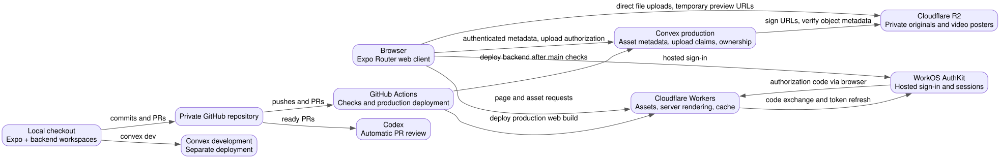

# ClearPath Marketing Compliance

A take-home project to increase marketing compliance review throughput for
ClearPath Financial, a fictional consumer finance company.

**Take Home Project - 24h**

- ClearPath Financial (fictional company) is a national consumer finance company that offers personal loans, credit cards, and mortgage prequalification products to consumers online.
- The company markets these products through typical marketing channels, including affiliate partners.
- The compliance marketing team’s review process which is currently done via Excel and email at the company is currently bottlenecking growth
- You are tasked with building a product that increases throughput of the compliance marketing team.
- Feel free to make reasonable assumptions
- Final Deliverable: URL to deployed project and Github Repo

## Architecture



Rendered from [docs/architecture.dot](docs/architecture.dot) by the pre-commit hook.

## Data flows

1. A browser loads the Expo Router app from Cloudflare Workers. Static assets
   are served directly; page requests use Expo's server renderer and Cloudflare's cache.
2. WorkOS hosts sign-in. The Worker exchanges the callback code and keeps a sealed
   session in an HttpOnly cookie. The browser loads account state through private
   auth endpoints; account data never enters the cached shell.
3. The app forwards the WorkOS access token to Convex for identity validation.
   The signed-in workspace saves immutable text and file assets. Convex keeps
   typed metadata and checks ownership; browser uploads go directly to private R2
   using temporary URLs. Video posters and sampled frames are separate private objects. Development
   uses a separate backend deployment and bucket.
4. A signed-in submitter can add a web page by URL. The Worker uses its Browser
   Run binding to render the page in Chromium, capture a full-page screenshot,
   and extract positioned visible text. The client uploads the screenshot and
   analysis tiles to private R2; Convex verifies and saves an immutable webpage
   asset with capture usage. See [asset storage and URL capture](docs/assets.md).
5. Upload completion starts reusable AssemblyAI transcripts and Gemini visual timelines.
   Submissions create immutable review versions. Convex schedules an AI first read,
   sends signed original audio/video URLs to AssemblyAI for timestamped transcription
   and sends the material bundle to OpenAI for structured
   multimodal review. Findings, per-attempt costs,
   and daily usage are persisted transactionally. Webpage quotes anchor to measured
   text-block boxes on the frozen screenshot. The reviewer triages findings
   and decides; a resubmission preserves the earlier version and rechecks requested
   changes. See [review flow and API](docs/review-flow.md).
6. Completed AI checks create owner-scoped attention notifications in the same
   transaction as their results. Convex updates the header's unread count and inbox
   reactively, even after leaving the review. The notifications page keeps the
   history; opening an item marks it read and deep-links to its review or policy
   target. Personal decisions, triage, and resubmissions stay quiet.
7. GitHub Actions checks pushes and pull requests. Ready pull requests receive
   automatic Codex reviews.
8. After checks pass on `main`, GitHub Actions exports the app with Convex's
   production URL, deploys the backend, and publishes the Cloudflare Worker.

Team sharing and separate reviewer permissions are not configured.

## Limits

Videos can be up to **3 minutes**. The upload box checks the recording's metadata
before sending any bytes; the backend checks the transcription provider's duration
before the AI review. Longer videos are refused with the same duration message,
rather than receiving a partial review. A video exactly three minutes long is
supported. If the server cannot confirm its length, the AI check fails and asks
for a fresh upload.

Within that limit, the browser keeps a poster and one frame per second. Transcript
word and segment bounds remain as database guards; any shortened speech text
keeps its visible coverage notice. Provider failures remain visible and a human
reviewer makes the final decision.

## Repository map

```text
clearpath_compliance_marketing/
├── AGENTS.md                   project instructions (CLAUDE.md links here)
├── README.md                   assignment brief and overview
├── expo/
│   ├── src/                    routes, asset workspace, header, auth, and themes
│   ├── worker/                 server rendering and WorkOS session endpoints
│   ├── scripts/                web export command
│   └── wrangler.jsonc          hosting configuration
├── backend/
│   └── convex/                 typed assets, private upload claims, JWT auth
├── docs/                       architecture and development guide
├── scripts/                    file limits, skill checks, diagram rendering
├── .agents/skills/             vendor Convex skills (.claude/skills links here)
├── .github/workflows/          checks and production deployment
├── .githooks/                  commit checks and diagram generation
├── .aliases.sh                 project development commands
└── package.json                npm workspaces and shared commands
```

## Guide

- **Open:** [live app](https://clearpath-marketing-compliance-web.aera.workers.dev),
  [private repository](https://github.com/pbanuru/clearpath_compliance_marketing).
- **Set up:** use Node from `.nvmrc`, then run `npm ci` at the root.
  Follow [local environment setup](docs/development.md#local-setup).
- **Run:** `npm run dev:backend` and `npm run dev:web` in separate terminals.
- **Check:** `npm run check`.
- **Deploy:** merge into `main`; [CI](docs/ci.md) checks and deploys the tested commit.
- **Read next:** [AGENTS.md](AGENTS.md) and [development and deployment](docs/development.md),
  [account authentication](docs/authentication.md), [appearance](docs/appearance.md), [asset storage](docs/assets.md),
  and [code review](docs/code-review.md).
