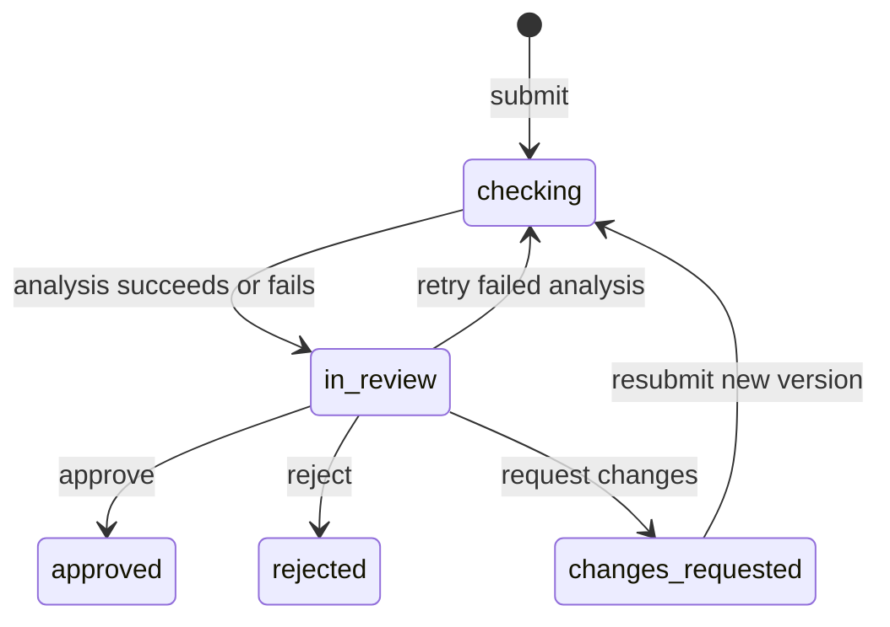

# Review flow

ClearPath Marketing Compliance uses one workspace per authenticated
`tokenIdentifier`. The same person submits and reviews. There are no shared-team
permissions or separate reviewer roles. Every public function derives ownership
with `requireOwner`; asset references, findings, versions, and responses are checked
against that workspace.

## Public contract

Call the following through the generated `api` bindings. Queries are reactive.
Mutations return `null` unless a return value is listed.

| Function                | Result                                                                                                                                                                                                                                                                                                                                                               |
| ----------------------- | -------------------------------------------------------------------------------------------------------------------------------------------------------------------------------------------------------------------------------------------------------------------------------------------------------------------------------------------------------------------- |
| `reviews.create`        | Review ID; creates version 1 and schedules analysis.                                                                                                                                                                                                                                                                                                                 |
| `reviews.list`          | Native Convex pagination (`page`, `isDone`, `continueCursor`, optional split metadata). Each row includes title, context, status, version, example, timestamps, `waitingSince`, `coverAssetId`, `cover: {kind, name}`, and active finding counts by severity.                                                                                                        |
| `reviews.counts`        | `{needs_review, changes_requested, approved, all}`. Rejected reviews count in `all`.                                                                                                                                                                                                                                                                                 |
| `reviews.get`           | `{review, versions, findings, decisions, events, transcripts, cost}`. Versions include immutable asset documents and analysis state. `transcripts` is a top-level, deduplicated array of `{assetId, status, segments: [{start, end, text}]}` for audio/video assets across all versions. `cost` is `{knownUsd, unknownCalls, spans}` across every version and retry. |
| `findings.setStatus`    | Accept, dismiss, or reopen a current finding; records an event.                                                                                                                                                                                                                                                                                                      |
| `findings.edit`         | Edit current finding wording or severity; records an event.                                                                                                                                                                                                                                                                                                          |
| `findings.add`          | New reviewer finding ID; starts accepted.                                                                                                                                                                                                                                                                                                                            |
| `reviews.decide`        | Records a version-specific decision and updates the queue.                                                                                                                                                                                                                                                                                                           |
| `reviews.resubmit`      | Creates the next version with ordered assets, responses, and optional submitter note; schedules analysis.                                                                                                                                                                                                                                                            |
| `reviews.retryAnalysis` | Queues another run after failed analysis while awaiting a decision.                                                                                                                                                                                                                                                                                                  |
| `policies.list`         | Sixteen static policy entries, including applicability and sources. Requires sign-in. Illustrative ClearPath standards without a public source have `source.url: null`.                                                                                                                                                                                              |

`needs_review` combines `checking` and `in_review`. Resubmissions sort before new
submissions, then oldest `waitingSince` first. Other lists sort newest updated
first. Indexed pagination reads only the requested page and one owned cover asset
per row. Sidebar totals and review cost totals are maintained transactionally in
`reviewCounts` and `reviewCosts`; queries do not scan all reviews or model calls.

A version supports 1–32 ordered assets. AI output is capped at 100 findings per run;
manual additions stop when the version already has 100 findings. Retrying failed
analysis retains manual findings, so that version can hold up to 200 in total. Reviews support up
to 100 versions. The detail query intentionally reads the review's complete
findings and event history, so normal Convex response and transaction limits still
apply to unusually large histories.

## States and decisions

Finding triage and edits require `in_review` and the current version. A stale
version cannot be decided. Approval requires no accepted findings; requesting
changes requires an accepted finding or a note. Open findings are dismissed with
`Not raised in decision` when a decision is recorded. Decisions retain the exact
accepted IDs and version; earlier material and events remain available.

A resubmission can respond only to accepted findings from its immediate previous
version. The model must recheck each of those findings. Resolved earlier findings
get status `resolved`; findings that remain are linked with `previousFindingId`.
Both outcomes save the explanation as `recheckNote` on the earlier finding.

## AI first read

Creation, resubmission, and retry schedule the internal `review/analysis.run`
action. A transactional start consumes the queued version once, assigns a
`runKey`, marks analysis running, and records an event. Duplicate or stale starts
do not make provider calls.

1. Audio/video of at most 25,000,000 bytes is transcribed with OpenAI `whisper-1`,
   `verbose_json`, and segment timestamps. Successful `assetExtractions` are reused
   by asset ID across versions. Larger recordings add an explicit skipped-speech
   note to the review input. Browser-captured frames provide separate visual
   evidence for video. Existing videos without frames use the poster and include
   a note that visual timing cannot be assessed.
2. One Responses request to `gpt-6.1-sol`, reasoning effort `high`, reads the whole
   bundle with context and any prior accepted findings, responses, and revision
   note. Images and sampled frames use high-detail base64 data URLs; PDFs use
   base64 `input_file` parts. Text and timestamped transcripts remain text. Every
   part is labeled with its asset ID and kind; frames include their time.
3. The reviewer instructions include ClearPath's established underwriting, credit
   inquiry, and applicant-specific pricing facts immediately after the opening
   paragraph. Claims contradicting those facts require changes; `needs_context`
   remains for unsettled facts. The applicable subset of the policy library follows. A strict JSON schema requests a short reviewer summary, findings with
   evidence locations, and recheck outcomes. Runtime parsing checks enums,
   locations, asset references, and that every prior accepted finding is covered.
   Unknown policy IDs become `other`. Exact text/transcript substring checks set
   `quoteFound`; an unmatched quote is retained for the reviewer to assess.
4. One finish mutation inserts findings, recheck notes and resolutions, extraction
   results, every attempt's spans, daily usage, and review cost totals, then marks
   analysis succeeded and the review `in_review`, with events. A failed transaction
   rolls back those writes together. Replaying a completed run cannot double count
   its spans.

Transport errors, HTTP 429/5xx, and invalid structured output get one retry per
operation. Other HTTP errors fail immediately. Both billed parse attempts retain
usage and cost. After failure the review is `in_review` for manual review, with a
readable analysis error and retry available. A missing `OPENAI_API_KEY` is reported
explicitly and does not invent a provider call.

The optional key is read only from the Convex environment. OpenAI receives the
review context and the submitted material, including private R2 bytes downloaded
by the action. Responses requests use `store: false`. No API key or private object
key signing API is exposed to the client. AI supports the reviewer and never
approves or rejects material.

Inline image/PDF/frame bytes are limited to 40 MiB per run to stay within action
memory and request limits; a larger bundle fails clearly for manual review or a
smaller submission. Sampling at most 16 frames cannot establish every moment of
a video or prove disclosure readability. Provider request IDs and estimates allow
later reconciliation; provider timeouts or process interruption do not establish
an invoice amount.

## Cost accounting

`aiSpans` records provider, operation, model, attempt, run/version, request ID,
latency, status, usage, pricing version, and optional error. Failed HTTP requests
without usage have unknown cost, and successful completions rejected by the
structured parser still retain billed usage. `aiUsageDaily` groups by owner, UTC
start day, provider, model, and operation. Calls, failed calls, known cost, and
unknown-cost calls are updated in the same mutation as span insertion.

`review/pricing.ts` pins Standard pricing read on 2026-10-28 from the
[OpenAI pricing page](https://developers.openai.com/api/docs/pricing):

| Model / input size                | Input / 1M | Cached input / 1M | Output / 1M |
| --------------------------------- | ---------- | ----------------- | ----------- |
| `gpt-6.1-sol`, ≤272K input tokens | $2.00      | $0.10             | $10.00      |
| `gpt-6.1-sol`, >272K input tokens | $4.00      | $0.20             | $15.00      |

`whisper-1` is $0.006/minute; `gpt-transcribe` is $0.0045/minute. The latter is
listed for accounting but is not selected because the current
[file-transcription documentation](https://developers.openai.com/api/docs/guides/speech-to-text)
limits `timestamp_granularities` to `whisper-1`. Whisper is scheduled for retirement
on February 26, 2027; revisit timestamp extraction before then.

Cached tokens are subtracted from ordinary input before pricing. Reasoning tokens
are already included in output. Missing required usage, an unknown model, or an
unknown unit produces `costUsd: null`, `costBasis: 'unknown'`, and increments
`unknownCostCalls`; it never becomes a zero-cost call. Known amounts are rate
estimates, not invoice charges. There are no spending caps or paywalls.

## Verification

`npm run check` includes the existing Convex/Vitest suite. Contracts exercise
workspace isolation, frame finalization, queue ordering, decisions and stale
versions, resubmission/recheck notes, inline media, transcript reuse, unknown cost,
parse retries, replay protection, and atomic rollback. Tests stub every external
OpenAI request; a separately authorized DEV smoke test exercises the real path.
Only DEV is deployed for this backend task.

## UI screens

- `/` shows a full-width signed-out landing or the signed-in Review Queue.
  Create account starts the existing login route with AuthKit’s `sign-up` screen
  hint; the existing PKCE, state, sealed-session, and origin protections remain. Sidebar
  links select `needs_review`, `changes_requested`, `approved`, or `all` through
  the `filter` query parameter. Queue rows show the cover, context, version,
  severity counts, status, and waiting time, and load more through native Convex
  pagination.
- `/submit` starts with files and pasted text, then asks for title, product,
  channel, jurisdiction, and optional context. The shared asset-upload hook keeps
  pending claims so interrupted files can retry. Submission waits for ready
  material and required context. Four bundled examples create real owned assets
  through the same flow and then create a review with an example badge.
- `/reviews/[id]` shows immutable versions, original material, AI findings, and
  the decision record. A finding location selects its asset and reveals the quote,
  image region, PDF page, or recording timestamp. Exact quote highlighting uses
  `quoteFound`; unmatched model quotes remain visible on the finding without
  marking unrelated material. Transcripts come from `reviews.get`.
- Findings show severity counts and reviewed progress above a compact list.
  Selecting a row expands its explanation, fix, and policy; inline Accept and
  Dismiss work while rows are collapsed. Dismissal reasons appear after dismissal.
  J/K or arrow keys move, A accepts, D dismisses, E edits, and U reopens. These
  shortcuts leave text fields and modal dialogs alone.
- Findings can be accepted, dismissed with an optional reason, reopened, edited,
  or added by hand. Added findings attach to the selected asset and the current
  playback time where appropriate. AI failure leaves manual review available and
  exposes the backend error with Try again. The decision bar explains that open
  findings will become not raised, and prevents approval with accepted findings.
  Approve is secondary and asks for confirmation while required findings remain
  unreviewed; notes expand only when needed.
- Changes requested exposes collapsible response rows for the recorded change
  list, with a response count and completion checks, and Keep or
  Replace controls for prior assets, plus additional uploads and a revision note.
  Text can be revised directly. The personal-loan example also offers its bundled
  revision. Versions remain selectable; comparison shows images side by side and
  a simple added/removed line view for text. Prior accepted findings show their
  recheck outcome and note. The collapsible history records the full workflow.
- `/policies` groups the policy library by kind, shows applicability, and links
  sources. A reviewer makes every decision.

Screen code lives in `expo/src/features/review/`; routes are thin Expo Router
entry points. No frontend credentials or role overrides are added. The same
signed-in workspace performs both submitter and reviewer actions.

During video uploads, poster and frame capture pauses its timeout while the tab
is hidden. The upload tile explains that it is waiting for this tab to become
visible; capture resumes on `visibilitychange`, without consuming the visible
30-second decoder timeout in the background. Retry preserves both the upload
claim and a revision replacement's target asset.

Example-only guidance follows actual triage and version state. Browser-local
preferences remember Hide guide and the finding, decision, and revision tips.
There are no overlay tours. The ? shortcut and sidebar keyboard link open a
reference for queue, finding, and control navigation; typing fields retain keys.
